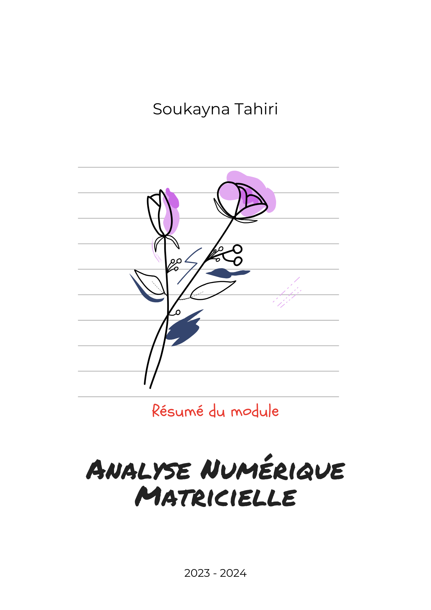
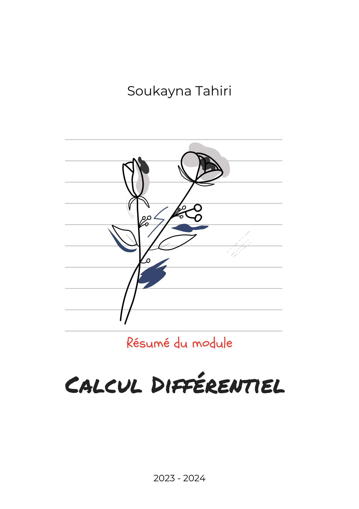

# Mathématiques Appliquées - FSTE

Résumé des chapitres des modules pour les Mathématiques Appliquées.
## Contenu
<table>
<tr>
<td width="35%" align="center">

  

</td>

<td width="65%" valign="top">

Contenu : 
- Chapitre  I : Généralités sur les Tribus
- Chapitre II : Applications Mesurables
- Chapitre II : Mesures Positives

</td>
</tr>
<tr>
<td width="35%" align="center">

  

</td>

<td width="65%" valign="top">

Contenu : 
- Chapitre  I : Intégrale des Fonctions Mesurables Positives
- Chapitre II : Fonctions Intégrables

</td>
</tr>

<tr>
<td width="35%" align="center">

  

</td>

<td width="65%" valign="top">

Contenu : 
- Chapitre I : Généralités sur les matrices
- Chapitre II : Méthodes directes pour la résolution de systèmes linéaires
- Chapitre III : Méthodes itératives pour la résolution d'un système linéaire

</td>
</tr>

<tr>
<td width="35%" align="center">

  

</td>

<td width="65%" valign="top">

Contenu : 
- Chapitre I : Généralités sur les espaces de Banach
- Chapitre II : Applications différentiables
- Chapitre III : Théorème des accroissements finis
- Chapitre IV : Théorème d'inversion locale et Théorème des fonctions implicites

</td>
</tr>

<tr>
<td width="35%" align="center">

  

</td>

<td width="65%" valign="top">

Contenu : 
- Chapitre I : Espaves métriques
- Chapitre II : Espaces topologiques
- Chapitre III : Applications continues et homèomorphisme
- Chapitre IV : Espaces topologiques compacts, connexes

</td>
</tr>

</table>

Bonne Lecture ⭐​.

